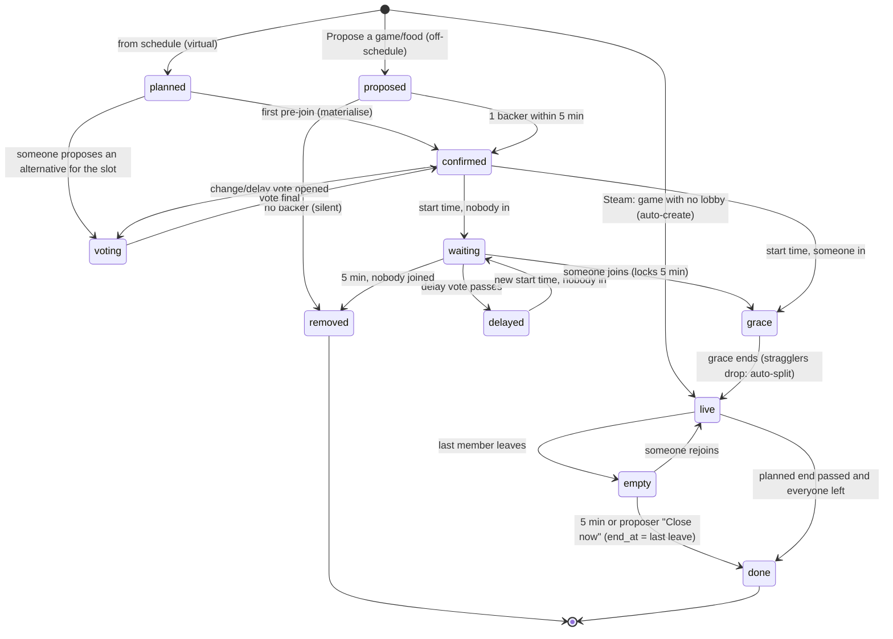

# caLANdar Live: design

Status: implemented (phases 0–4) · draft v2 with decisions folded in · 2026-10-19. See §11 for how the build differs, and TESTING.md to try it.
Source: `Live Event Dashboard Design.zip` (README, `Live Event.dc.html` prototype, `Live Dashboard.dc.html` storyboards F1–F13)

**The schedule and Live are two views of one thing.** Both read and write the same set of sessions:

- `/schedule` is the _ahead-of-time_ planning view.
- `/live` is the _during-the-event_ view.

A lobby **is** a schedule entry. Whatever is played, moved, split or extended on Live is the schedule from then on. Section 4.5 covers how this works.

---

## 1. What we're building

There are two surfaces:

- `/events/:id/live` is a new event tab, "02 Live", placed directly after Overview. It holds the me strip, the timeline of lobbies, lobby details, up next, the floor, and the feed (open votes pinned, then history). It also has the toast stack, the admin FAB and the propose/vote sheet.
- `/live/:token` is a no-login, read-only wall-board for the TV, drawn on a scaled 1920×1080 canvas.

The page's job is to keep the LAN running smoothly **during** the event. That puts four demands on the architecture:

1. **It should feel instant.** A vote, join or Steam switch should reach every screen in under about a second.
2. **It can't drift.** Countdowns for graces and deadlines must agree on every device, including the TV.
3. **It has to survive real networks.** Venue Wi-Fi, phones locking, laptops sleeping and Cloud Run recycling an instance mustn't lose or duplicate updates.
4. **Rules run on the server.** Graces expire, proposals lapse and parties split even when nobody has the page open.

---

## 2. Constraints from the current system

These facts drive the design:

| Fact                                                                                                                                          | Where                                                             | Consequence                                                                                                                                        |
| --------------------------------------------------------------------------------------------------------------------------------------------- | ----------------------------------------------------------------- | -------------------------------------------------------------------------------------------------------------------------------------------------- |
| Netlify proxies `/api/*` to Cloud Run and **cuts requests at about 26s**                                                                      | `frontend/vite.config.ts:31-63`, `api/src/controllers/game.rs:91` | The SSE stream **can't go through the Netlify proxy**. It has to connect directly to the Cloud Run origin.                                         |
| Cloud Run `--timeout 60s`, `min 0` / `max 10` instances, default concurrency 80, CPU throttled outside requests                               | `Justfile:308-322`                                                | Raise the timeout for streams. We need **cross-instance fan-out**. Background work can only rely on CPU while a request (a stream counts) is open. |
| The last three commits moved the Steam refresh into a Cloud Run Job specifically to **avoid `--no-cpu-throttling` billing**                   | `264731c`                                                         | No always-on pollers in the service. Timers must be deadline-driven and must catch up after the fact.                                              |
| Auth is a **Bearer header only**; admin needs `?as_admin=true`                                                                                | `api/src/auth.rs:37-184`                                          | Native `EventSource` can't authenticate. We need a scoped stream token.                                                                            |
| Rocket 0.5 ships `EventStream`; sqlx 0.8 has `PgListener`                                                                                     | `Cargo.toml`                                                      | Both building blocks exist, with no new dependencies.                                                                                              |
| DB is Supabase, pool default of 10 per instance                                                                                               | `main.rs:373`                                                     | `LISTEN` needs a **session-mode or direct** connection. The transaction pooler drops it. Streams must never hold a pooled connection each.         |
| `get_current_game` stub: one ID per call, plain `http`, fragile struct (`commentpermission`/`primaryclanid` non-Option), no `gameextrainfo`   | `api/src/repositories/steam_api.rs:282-327`                       | Rewrite it as a batched `get_player_summaries(ids[..100])` with lenient deserialisation.                                                           |
| The schedule persists **pinned rows only**. Suggestions are **recomputed on every GET**.                                                      | `controllers/game_schedule.rs:141-320`, `scheduler.rs`            | Planned lobbies can't have stable IDs just by reading the schedule. See §4.5.                                                                      |
| The planning view is **single-track**. The frontend's `findClash` blocks overlapping sessions, and the backend `has_overlap` is never called. | `EventGameSchedule.tsx:637`, `repositories/game_schedule.rs:205`  | Reality has parallel lobbies, so the schedule view must learn **lanes** (§4.5).                                                                    |
| The planner's default session length is a hard-coded 120 min                                                                                  | `controllers/game_schedule.rs:276`                                | Replace it with the learned typical length (§5.6).                                                                                                 |
| Attendance is **6-hour buckets** (06/12/18/00 UTC)                                                                                            | `controllers/event_invitation.rs:25`                              | Answering "everyone attending at 22:00" means using the 18:00 bucket. That's coarse but workable.                                                  |
| The only backend tests are inline unit tests. The pure `scheduler.rs` is the pattern to copy.                                                 | n/a                                                               | The live rules engine should be a **pure, unit-tested module**, separate from I/O.                                                                 |
| The frontend uses raw `fetch` with no query library. The ActivityTicker polls every 30s.                                                      | `ActivityTicker.tsx:338`                                          | Build one small `LiveStore`. The ticker can switch to the same stream later.                                                                       |
| The frontend is on **MUI v9**, not v7 as the handoff says                                                                                     | `frontend/package.json`                                           | Use the hl primitives as they are. There's no hl `Button`; the themed MUI `Button` is already chamfered.                                           |

---

## 3. Architecture

```
 Browser (gamer / admin)                                   Wall-board TV
   │ REST commands (via Netlify /api proxy, unchanged)        │
   │ SSE stream (direct to calandar-live, ?st=<token>) ───────┼──────────────┐
   ▼                                                          ▼              ▼
┌── Cloud Run: calandar-api (0-10, 60s timeout) ──┐   ┌── Cloud Run: calandar-live (0-2, 3600s) ──┐
│ routes/live.rs ─► controllers/live.rs           │   │ LiveHub                                    │
│        └─► live::engine (pure) ─► one txn:      │   │  ├─ one PgListener ◄── NOTIFY ─────┐       │
│            rows + INSERT live_log + pg_notify ──┼───┼──┘                                 │       │
│ POST /internal/live/tick ◄── Cloud Scheduler 1m │   │  ├─ broadcast per event ─► SSE subscribers │
│ (backstop: ticks + Steam when nobody watches)   │   │  └─ while streams are open (leader lock):  │
└─────────────────────────────────────────────────┘   │      engine tick every 2s · Steam every 30s│
                       both ──► Postgres (Supabase)    └────────────────────────────────────────────┘
```

### 3.1 Pure core, imperative shell

`api/src/live/engine.rs` is pure Rust with no sqlx and no clock reads. It's unit-tested the same way as `scheduler.rs`.

```rust
fn apply(state: &LiveState, input: Input, now: DateTime<Utc>) -> Result<Outcome, Reject>
enum Input { Command { actor, cmd: Command }, Tick, Presence(Vec<PresenceSample>) }
struct Outcome { changes: Vec<Change>, log: Vec<LogEntry> }   // Change = upsert/delete of a lobby, vote, member…
```

Every rule in the handoff lives here and nowhere else: graces, backers, unanimity, splits, running over, Steam-switch grace. The controller does four things:

1. Takes `pg_advisory_xact_lock(event_id)`.
2. Loads `LiveState` for the event.
3. Calls `apply`.
4. Writes the changes and log rows, then `pg_notify`s, all in **one transaction**.

The per-event lock serialises every mutation for an event. That's appropriate at LAN scale (tens of people, a few writes per second at most) and removes a whole class of race conditions, such as two people joining the last slot at once.

A storyboard scenario (`sc=split1`, `nojoin3`…) becomes a **test fixture**: a given state, then inputs and ticks, then an expected state and log. The 13 storyboard flows become the engine's acceptance suite.

### 3.2 One append-only log: the feed, the deltas and the replay cursor

```sql
CREATE TABLE live_log (
  seq        BIGSERIAL PRIMARY KEY,
  event_id   INT NOT NULL REFERENCES event(id) ON DELETE CASCADE,
  at         TIMESTAMPTZ NOT NULL DEFAULT now(),
  actor      TEXT,                 -- email, 'steam', 'system', 'admin:<email>'
  kind       TEXT NOT NULL,        -- 'lobby.upsert', 'vote.upsert', 'feed', 'toast.admin', 'presence' …
  tier       SMALLINT,             -- feed tier 1-4, NULL for state-only deltas
  audience   TEXT,                 -- NULL = everyone; 'email:<x>' for personal; 'admin'
  payload    JSONB NOT NULL
);
CREATE INDEX live_log_event_seq ON live_log(event_id, seq);
```

Every write produces log rows, and those rows serve three purposes:

- **SSE deltas.** Each row is one SSE message, `id: <seq>`. Payloads are **full entity snapshots** (the whole lobby or the whole vote), not patches. The client reducer is then just an upsert by ID, so replays are idempotent and ordering bugs can't corrupt state.
- **The feed.** Rows with a `tier` are the history feed (T1 result … T4 presence). The ActivityTicker can read them later too.
- **Reconnect.** The client resumes with `Last-Event-ID`, and the server replays `seq > n`. If the gap is larger than 500 rows or older than 15 minutes, the server sends `event: reset`, and the client refetches the snapshot.

`audit_log` keeps its compliance role. Live writes a summary there via `log_audit`, but doesn't depend on it.

### 3.3 Fan-out across instances

- Each instance runs **one** `PgListener` on channel `live`, using a direct/session connection from `DATABASE_URL_LISTEN`. The NOTIFY payload is just `"<event_id>:<seq>"`, well under the 8 KB limit.
- On a notify, the instance reads `live_log WHERE event_id=$1 AND seq > $last` **once** and pushes the rows to a `tokio::sync::broadcast` channel for that event. Every local SSE subscriber reads from that channel. So 50 connections on an instance cost one query per change, not 50.
- **Safety net:** while it has subscribers, each instance also polls `max(seq)` every 5 seconds. A dropped LISTEN connection, which Supabase restarts can cause, then delays updates by at most 5s instead of breaking them. If Supabase can't offer a session connection at all, this poll at 1s becomes the whole mechanism. That still works fine at our scale.
- Per-audience filtering (`email:` or `admin`) happens at the subscriber. Personal rows never go to other people's streams, and the wall-board only gets `audience IS NULL`.

### 3.4 The stream endpoint

`GET <cloud-run-origin>/api/events/:id/live/stream?st=<token>` returns `text/event-stream` (Rocket `EventStream!`):

- **Messages:** `id: seq`, `event: <kind>`, `data: <json>`.
- **Heartbeat:** a `: ping` comment every 15s. Each ping includes the server time, so clients keep their clock offset fresh.
- **Graceful recycle:** the server closes the stream itself after 50 minutes with `event: reconnect`, under a Cloud Run `--timeout 3600`. It also closes on Rocket `Shutdown`, so deploys and scale-downs look like normal reconnects.
- **Holds no DB connection.** A stream only reads from the broadcast channel.
- **Auth:** the stream token `st` is a PASETO v4.local with token id `live`. Its claims are `{event_id, sub: email | "wallboard", admin: bool}` and it lasts 12h. It's minted by `POST /api/events/:id/live/stream-token`, a normal Bearer-authenticated call through Netlify. The response also returns `streamUrl`, the absolute Cloud Run origin, which means **the frontend needs no new build-time config** and staging and production just work.
  - The token is read-only and scoped to one event's stream. Leaking it exposes no more than the wall-board link already does.
  - The wall-board exchanges `wallboardToken` for an `st` with `sub: "wallboard"`.
- **CORS:** the current fairing already allows `calandar.org`, `*.calandar.netlify.app` and localhost. A GET with a query param is a simple request, so there's no preflight.

Native `EventSource` gives us automatic reconnect and `Last-Event-ID` for free. It works on the TV's browser, needs no dependency, and uses the same code path for gamers and the wall-board. This is why it beats a fetch-based reader with a header.

**Deploy changes.** Streams are served by a **dedicated `calandar-live` Cloud Run service**. §3.8 explains why.

- **Same image, new subcommand.** It runs `calandar-api serve-live`, in the same way the Steam Job runs `calandar-api refresh-steam-games` from the same binary today.
- **Live service flags:** `--timeout 3600 --concurrency 1000 --cpu 1 --min-instances 0 --max-instances 2`. Rocket is async, so a stream costs about one task plus one broadcast receiver.
- **The API service is unchanged.** It keeps `--timeout 60s` and scales to zero.
- **New config:** a secret `DATABASE_URL_LISTEN`, and an explicit `PgPoolOptions` (`max_connections` 10, `acquire_timeout` 5s) on both services, so a burst of commands can't starve the pool.
- **Stream URL:** `stream-token` returns the `calandar-live` URL as `streamUrl`.

### 3.5 Commands (writes)

Commands are plain REST POSTs through the existing `/api` proxy, for example `POST /api/events/:id/live/lobbies/:lid/prejoin`. The full list is in §6.

- Each request carries an `Idempotency-Key` (a UUID). It's stored in `live_command(event_id, key, result)` for 10 minutes, so retries on bad Wi-Fi are safe.
- The response is `{ seq }` plus the updated entity. The client applies the entity right away, so you see your own action without waiting for the stream. The SSE echo with the same seq is then a no-op.
- If the engine rejects a command, it returns `409 { reason }`, for example "lobby full" or "vote already final". The client rolls back its optimistic change and shows a notistack error. Notistack stays as the channel for errors only.

### 3.6 Timers without an always-on CPU

Every timed rule is a stored **deadline**:

- `lobby.grace_until`
- `lobby.empty_since + 5m`
- `vote.backer_deadline`
- `vote.deadline`
- `member.switch_grace_until`

`engine::apply(Tick, now)` processes every deadline at or before `now` and is idempotent. Ticks come from three places:

1. **Inline:** before every command and every snapshot read. State is therefore never stale when someone looks at it.
2. **The `calandar-live` ticker,** every 2 seconds, but only while that instance has SSE subscribers for the event. CPU is allocated then, because the stream request is open. `pg_try_advisory_lock(hash('live-tick', event_id))` picks a single leader across instances, and the others skip.
3. **Cloud Scheduler,** calling `POST /api/internal/live/tick` once a minute, authenticated with a Cloud Scheduler OIDC token. This is the backstop for times with nobody connected, such as 04:00 with the TV off. A proposal might then lapse up to a minute late, and no one is watching to notice.

Countdowns never depend on tick timing. Clients render `deadline − (Date.now() + serverOffset)`, and a server transition that lands 2 seconds late just snaps the UI to the new state.

### 3.7 Steam presence

Steam is polled from the same leader ticker, **every 30 seconds while the event is live**. One request covers all checked-in attendees who have a `steam_id`, since `GetPlayerSummaries` takes up to 100 IDs. At 2,880 calls a day, that's far below the 100k/day key limit.

1. **Rewrite the stub.** Replace it with `get_player_summaries(&[i64]) -> Vec<PlayerPresence { steam_id, gameid: Option<i64>, game_name: Option<String> /* gameextrainfo */, persona_state }>`:
   - Use HTTPS.
   - Every field except `steamid` is `Option`.
   - Keep `.without_url()` so the key never reaches logs.
2. **Debounce.** A new `gameid` has to show up in **two consecutive polls** (about 30–60s) before it counts. This stops a 20-second "launch to patch" from creating a lobby and a feed entry. Going AFK (`personastate` 3 or 4) is debounced the same way.
3. **The engine decides.** Debounced samples become `Input::Presence`, and the engine applies the presence rules in §5.1. Only _changes_ produce log rows.
4. **Only checked-in people count.** Steam presence from someone who hasn't checked in **never** puts them in a lobby, because they might be playing at home. It only produces the admin "playing but not checked in" card.
5. **Privacy fallback.** If a profile is private, `gameid` never comes back. After a check-in where 2 polls in a row show the person online but return no game data, they get a one-time hint: "Steam isn't sharing your game. Join lobbies manually, or make _Game details_ public." They're then treated as manual.

Later, an optional `presence_source` per gamer could support other launchers: a Discord Rich Presence bot, or a tiny desktop agent. The engine only sees `PresenceSample { email, game_id?, via }`, so new sources slot in without engine changes.

---

### 3.8 Cost: hold connections only while someone is looking

**How Cloud Run bills this.** Billing is request-based, so an instance costs money for every second it has **at least one request open**. An open SSE stream is an open request. The cost is therefore roughly _the hours during which at least one stream is open × one instance_, whatever the number of viewers. At the current request-based rates (about $0.000018 per vCPU-second and $0.000002 per GiB-second):

| Scenario                                                                                 | Instance-hours | Approx. cost |
| ---------------------------------------------------------------------------------------- | -------------- | ------------ |
| A 48h LAN weekend with the TV on throughout (the worst realistic case), 1 vCPU / 512 MiB | 48             | **≈ $3.30**  |
| The same, but only while somebody actually has the page open                             | 30–48          | ≈ $2–3.30    |
| Between events                                                                           | 0              | $0           |

The monthly free allowance is 180,000 vCPU-seconds, about 50 vCPU-hours. A whole LAN weekend **probably fits inside the free tier**, provided the API's own usage that month is small. Keeping connections open isn't expensive at this scale. The real risks are **accidental always-on**: a forgotten tab, or streams opened weeks before the event, both of which the measures below prevent.

**Why there's no "cheaper SSE node" on Cloud Run.** Going below 1 vCPU forces `concurrency = 1`, which means **one instance per viewer**. That's strictly more expensive. A 1 vCPU instance serving 1,000 streams is already the cheapest shape. A dedicated service is still worth having:

- The API keeps its 60s timeout, which protects it from hung requests.
- With max 2 instances, there's effectively **one** stream instance. That makes it the natural ticker and Steam-poll leader.
- Commands on the API service bill only for their few milliseconds each.
- Separate services show the cost of streaming on its own line in billing.

**Measures that keep streams open only while someone is watching.** These are built into `connection.ts` and the stream endpoint:

1. **Hidden tabs disconnect.** On `visibilitychange`, if the page has been hidden for **2 minutes**, the client closes the stream. When the page becomes visible again, the client reconnects with `Last-Event-ID`, and the server replays what was missed, so it feels seamless.
2. **No streams outside the live window.** The client only opens a stream from **doors − 2h to the event end + 1h**. Outside that window, during the lead-up, the page polls the snapshot every 60 seconds while visible, which is plenty when nothing happens in real time.
3. **A server-side idle cap.** The server closes a stream after 50 minutes (§3.4). It also closes streams after **4 hours with no user interaction**, using a ping from the client on input. This catches the forgotten laptop. It doesn't apply to the wall-board.
4. **The wall-board can sleep.** An optional admin setting turns off the TV stream between, say, 03:00 and 09:00. Out-of-event hours already behave like the lead-up: a static countdown plus a 5-minute poll.
5. **Ticks without a stream** come from Cloud Scheduler once a minute, which is a ~100 ms request when nothing is due. The endpoint returns immediately unless an event is live. Steam polling falls back to that same one-minute rhythm when nobody is connected. A slower update is fine when nobody is looking, and it still records reality for the history.
6. **Client-triggered ticks.** When a countdown that a client is showing reaches zero, the client sends a debounced `POST /live/tick`. Transitions then land within about a second, even if the stream instance's 2-second loop isn't running.

**Plan B, if streaming ever turns out costly or awkward: Supabase Realtime.** We already use Supabase. Its Broadcast feature would replace the Cloud Run stream entirely:

- The API publishes to channel `event:<id>`, and clients subscribe using a JWT that Cloud Run mints with RLS on `realtime.messages`.
- The free plan includes 200 concurrent connections and 2M messages a month.
- The cost is a WebSocket client library, Supabase-JWT minting and vendor coupling. Ticks then rely only on points 5 and 6.

The client's `connection.ts` sits behind a small `LiveTransport` interface (`subscribe(sinceSeq, onRow)`), and replay always comes from `live_log`. So this swap would be contained to one file on the client and one publisher on the server.

## 4. Data model

### 4.1 Event additions

```sql
ALTER TABLE event ADD COLUMN discord_invite_url TEXT,
                  ADD COLUMN wallboard_token TEXT UNIQUE,          -- random, rotatable by admin
                  ADD COLUMN timezone TEXT NOT NULL DEFAULT 'Europe/London',  -- replaces the ?tz default
                  ADD COLUMN venue JSONB;                           -- {placeId,lat,lng,name} for Places (phase 4)
```

### 4.2 Live tables

```sql
live_checkin   (event_id, email, checked_in_at, by_email, PRIMARY KEY (event_id, email))

game_lobby_defaults (game_id BIGINT PRIMARY KEY,     -- "saved for everyone", global across events (§5.6)
                     max_players INT, teams JSONB,   -- [{name, size}]
                     duration_minutes INT NULL,      -- explicit override; otherwise the learned typical length
                     set_by TEXT, set_at TIMESTAMPTZ)

-- The lobby IS the schedule entry: extend event_game_schedule rather than adding a parallel table.
-- (Called "lobby" below. Existing columns: id, event_id, game_id, start_time, duration_minutes,
--  is_pinned, created_at, last_modified. start_time/duration_minutes stay "the current best time":
--  the actual time once played, otherwise the planned or moved time, so the existing GET keeps working.)
ALTER TABLE event_game_schedule
  ALTER COLUMN game_id DROP NOT NULL,
  ADD COLUMN kind TEXT NOT NULL DEFAULT 'game' CHECK (kind IN ('game','food')),
  ADD COLUMN food JSONB NULL,                -- {placeId?, name, photoRef?, freeText?}
  ADD COLUMN status TEXT NOT NULL DEFAULT 'planned',
      -- planned|proposed|confirmed|waiting|delayed|grace|live|empty|done|removed
  ADD COLUMN source TEXT NOT NULL DEFAULT 'plan',   -- plan|suggestion|proposal|steam|split
  ADD COLUMN planned_start TIMESTAMPTZ NULL, ADD COLUMN planned_minutes INT NULL,  -- frozen at first live change
  ADD COLUMN actual_start TIMESTAMPTZ NULL, ADD COLUMN actual_end TIMESTAMPTZ NULL, -- NULL end = still running
  ADD COLUMN max_players INT NULL, ADD COLUMN teams JSONB NULL,
  ADD COLUMN proposed_by TEXT NULL, ADD COLUMN created_by_vote BIGINT NULL,
  ADD COLUMN grace_until TIMESTAMPTZ NULL, ADD COLUMN grace_locked BOOL NOT NULL DEFAULT false,
  ADD COLUMN empty_since TIMESTAMPTZ NULL,
  ADD COLUMN version INT NOT NULL DEFAULT 0;

lobby_member (                -- one row per presence interval: the audit lens and plan-vs-actual read it
  lobby_id, email, team TEXT NULL, via TEXT CHECK (via IN ('steam','manual','admin')),
  joined_at TIMESTAMPTZ, left_at TIMESTAMPTZ NULL, left_reason TEXT NULL)   -- switched|afk|split|ended

lobby_prejoin (lobby_id, email, team TEXT NULL, random_team BOOL, created_at,
               dropped_at NULL, drop_reason NULL, PRIMARY KEY (lobby_id, email))

live_presence (event_id, email, game_id NULL, game_name NULL, persona_state,
               via, observed_at, switch_grace_until NULL, PRIMARY KEY (event_id, email))   -- latest only

vote (
  id BIGSERIAL, event_id, type TEXT,      -- new_lobby|slot|change|delay|extend|kickoff
  target_lobby_id NULL, slot_start NULL,
  status TEXT,                            -- open|final|vetoed|lapsed
  resolution TEXT NULL,                   -- unanimous|everyone_split|admin_pick|admin_split|deadline|backed
  -- no eligible[] column: "involved" is recomputed from live state per vote type (§5.3.3)
  opened_by, opened_at, deadline NULL, backer_deadline NULL, resolved_by NULL, resolved_at NULL)

vote_option (id, vote_id, kind TEXT,      -- game|food|keep_playing|shift|yes|no|time
             game_id NULL, food JSONB NULL, start_delta_min INT NULL, duration_min INT NULL,
             lobby_id NULL,               -- for options that are existing lobbies
             created_by, created_at)

vote_ballot (vote_id, email, option_id NULL, split_ok BOOL DEFAULT false, updated_at,
             PRIMARY KEY (vote_id, email))

live_command (event_id, idempotency_key UUID, response JSONB, created_at, PRIMARY KEY (event_id, idempotency_key))
live_log (§3.2)
```

**Admin posts** are `live_log` rows: `kind='toast.admin'` with a payload of `{text, ttl: '10m'|'dismiss', tv: bool}`.

**Toasts are not stored per user.** The client derives them (§7.3). That removes a table, removes a fan-out, and avoids "the server thinks I have a toast I already dismissed" bugs.

### 4.3 Snapshot

`GET /api/events/:id/live` returns everything a client needs to render, plus the cursor:

```json
{ "seq": 18342, "serverTime": "...", "event": {...discordInviteUrl, timezone},
  "me": {"email","checkedIn","isAdmin","presence":{...}},
  "people": [{"email","handle","avatarUrl","seat","attendance":[…],"checkedIn","presence"}],
  "lobbies": [...], "votes": [...], "plan": [...planned, not yet materialised],
  "feed": [... last 200 tiered rows], "floor": {"rooms":[...], "seats":[...]} }
```

The wall-board version strips emails. People are keyed by an opaque `pid` everywhere in the live API, so that's a projection rather than a second API.

### 4.4 Lobby lifecycle



`voting` is the timeline label "VOTE OPEN". It's really "there's an open vote targeting this lobby or slot", so it's stored as a derived flag rather than as a status.

### 4.5 One schedule, two views

`event_game_schedule` is the single store for sessions. Every row is a lobby. The two pages are lenses on it:

|             | `/schedule` (planning ahead)                                                             | `/live` (during the event)                                                          |
| ----------- | ---------------------------------------------------------------------------------------- | ----------------------------------------------------------------------------------- |
| Shows       | Every row, plus computed suggestions, on day cards and a timeline                        | Every row, plus suggestions, as lanes with a NOW line, presence, votes and the feed |
| Admin edits | Drag, resize, pin and delete, **without a vote** (the admin override)                    | Inline admin strip: Edit, End, Remove, Force                                        |
| Gamer edits | Votes on games (unchanged)                                                               | Propose, pre-join, vote, join                                                       |
| Freshness   | Subscribes to the same live stream while the event is live, and stays as it is otherwise | The live stream                                                                     |

Each schedule-page edit goes through the **same command path and engine** as Live: one lock, one log row and one broadcast. An admin dragging DRG on `/schedule` therefore moves it on every Live screen and on the TV, and the feed gets an "Admin moved DRG to 22:30" line.

**Row lifecycle.** Every row moves through these steps:

1. **Planned.** There are two kinds:
   - An admin-pinned row (`source='plan'`, `status='planned'`).
   - A **suggestion**, which is computed and not stored. It has a stable virtual ID `s<gameId>@<startMs>`, following the existing `sessionKey` convention, and appears as a planned lobby with 0 players.
2. **Materialised.** The first interaction with a suggestion (a pre-join, a vote, or the start time arriving) inserts a row with `source='suggestion'`. Re-planning can then no longer move the lobby or pull it out from under anyone who has pre-joined.
3. **Changed during the event.**
   - The first live change freezes `planned_start` and `planned_minutes`. Later changes then update `start_time` and `duration_minutes`.
   - Lobbies auto-created from Steam, proposals and splits are new rows with no planned time.
   - That's how "Plan vs actual" (F10.1) is recorded without a second table.
4. **Played.** `actual_start` and `actual_end` come from real presence, so the row records what actually happened. This is the handoff's "the actual time is pinned back to the schedule", read literally.
5. **Removed.**
   - An unbacked proposal is deleted.
   - A planned lobby nobody joined goes to `status='removed'`, which keeps it out of both views. If it came from a suggestion, the row is deleted, so the game **goes back into the planner's pool** automatically.

**Re-planning from what's left.** The planner only plans the **future**: suggestions start at `max(now, event start)`. Every stored row that isn't `removed` counts as an occupied game and time, whether it's planned, confirmed, live or done. That's F10's "the schedule re-plans from what's left", achieved with no planner algorithm change. The changes are in what `schedule_suggested_games` passes in (`controllers/game_schedule.rs`); `scheduler.rs` itself is unchanged.

**Consequences for the existing schedule page.**

- **Lanes.** Reality overlaps, for example two lobbies running side by side after a split. `ScheduleTimeline` needs to pack lanes greedily, using the same `pack()` as Live (shared in `scheduleModel.ts`).
- **Clashes.** `findClash` stops being a hard block. It still warns about clashes in admin _planning_ edits, but rows that came from Live are allowed to overlap.
- **Past rows.** Played rows render as "played", with their actual times. Admins can still correct them, but with a confirm step, because they're history.
- **API.** `GameScheduleEntry` gains `status`, `kind`, `food`, `plannedStart`, `plannedMinutes`, `actualStart`, `actualEnd`, `teams` and `maxPlayers`. Today's consumers read only the existing fields, so the change is additive.

**Food.** Food is proposal-only (decision Q6). The schedule still shows food rows once they exist, as violet hatched blocks, but the planner never invents meals.

---

## 5. Rules engine: decisions and fixes for gaps in the handoff

The handoff's flows are mostly coherent. Below are the places where the rules, as written, contradict each other or leave a gap the engine has to fill. Each item states the gap, then **the rule**. All of them were agreed on 2026-10-19; the decision log is §9.

### 5.1 Presence

1. **Manual users can't leave.** There's no "leave" or "not playing" action, so a manual "now" would last forever, and lobbies of manual-only players would never empty.
   → **Add a Leave action. This is a design addition the handoff lacks.** It goes in two places (not the Call vote ▾ menu: leaving isn't a vote):
   - the NOW chip in the me strip, as a `Leave` text button next to the game name;
   - the lobby details actions for a live lobby you're in, as `Leave lobby`;

   Leave works for Steam users too: it ends your membership until Steam shows a _different_ game, so a game left running in the background doesn't pull you back in. A manual "now" also expires when the lobby's planned end plus 30 minutes passes, unless you answer a lime "Still playing X?" toast.

2. **What happens after the Steam-switch grace isn't specified.** The handoff says that if you manually join B while Steam shows A, you get 5 minutes to launch B.
   → If you don't launch B in time, the manual join of B is **converted to a pre-join** of B (not dropped), and you stay in A. You lose nothing, and there's no surprise.
3. **Two live lobbies of the same game,** for example after a split, or two CS2 groups. Steam only tells us the `gameid`.
   → Resolve in this order:
   1. The lobby you're currently in.
   2. The lobby you're pre-joined to.
   3. The lobby with the most of your seat neighbours.
   4. The most recent lobby.

   You can always correct it manually, and a manual pick wins while the `gameid` matches.

4. **Food versus Steam.** You won't be launching anything while eating, and Steam may still show CS2 in the background.
   → While you're a member of a live **food** lobby, a game Steam already showed (or stops showing) doesn't change your lobby. _Launching_ a game does: Steam's game changing to a new one means you've finished eating, and you move to that game's lobby like any other switch (changed after the first manual test, when launching the next game from a food lobby didn't move you). Food membership is manual, or comes from the vote or the split. You leave by pressing Leave, or automatically at the food lobby's end.
5. **Auto-create noise.** This is handled by the debounce in §3.7. The **setup toast** only shows the _first_ time a game is ever seen, meaning when no `game_lobby_defaults` row exists. After that, the defaults apply silently.
6. **AFK** (`personastate` Away/Snooze held for more than 10 minutes, debounced) shows on the floor at 40% opacity and in the audit lens. It does **not** remove you from the lobby. Otherwise the lobby would empty when people step away.

### 5.2 Proposals versus votes: "everything is a vote", made precise

The handoff uses "vote" for two different things, and the unanimity rule only works for one of them.

|                | **Additive: "Propose a lobby"**                                                                    | **Competitive: "Decide something"**                                                                                  |
| -------------- | -------------------------------------------------------------------------------------------------- | -------------------------------------------------------------------------------------------------------------------- |
| Examples       | Propose a game or food that runs _alongside_ others (Phasmophobia at 22:00, L4D2 at 21:00)         | What's on at 22:00 · change · delay · keep playing · kick off early                                                  |
| Who it affects | Only the people who join                                                                           | Everyone eligible                                                                                                    |
| Final when     | **1 backer** (a pre-join, or a "yes") within 5 min → `confirmed`. Otherwise it's removed silently. | **Unanimous** among the people involved (§5.3.3), or an admin forces/splits/vetoes, or the deadline arrives (§5.3.2) |
| Feed T1        | "FINAL · BACKED"                                                                                   | "FINAL · UNANIMOUS / ADMIN PICK / EVERYONE SPLIT"                                                                    |

The L4D2 history card in the prototype ("NEW LOBBY · FINAL · UNANIMOUS", 4 yes votes) is really the additive case. The badge should read **BACKED**, or the count should be the backers.

**When proposing, the sheet decides which kind applies:**

- If the chosen time **overlaps a planned or confirmed lobby that the proposer has pre-joined or is eligible for**, the sheet asks: **"Add as an option to _What's on at 22:00?_"** or **"Run alongside"**. Adding as an option is the default; "Run alongside" has to be picked.
- Otherwise it's simply additive.

This is the one new UI element the design needs (a two-option chip row in the sheet footer).

### 5.3 Competitive votes

1. **Slot votes have no defined trigger.** The prototype shows a slot vote "opened by the schedule · 19:30", but the README never says when one opens.
   → A slot vote opens **only when someone challenges a planned or confirmed lobby**, either by proposing an alternative and choosing "add as option", or by pressing "Propose a change". When it opens, the planned game is option 1. "Keep playing ⟨current⟩" is auto-added for each live lobby that ends before the slot. Uncontested plans need no vote, which keeps the feed quiet.
2. **Unanimity versus liveness.** With 10 eligible people, unanimity is rare, and the admin is usually mid-game. The prototype shows `CLOSES 21:45`, but nothing says what happens then.
   → Every competitive vote has a `deadline`. For slot votes it's start − 15 min, and for delay votes it's 3 minutes, while the grace is held (§5.4.1). At the deadline, if it's still open, the vote resolves:
   - If every voter ticked split, it splits.
   - Otherwise the **plurality winner** takes it, and the feed shows the badge `FINAL · CLOSED`.
   - Options with at least `min_players` voters who also ticked split get their own lobby.
   - A tie goes to the planned option, then to the earliest-created option.

   The admin can still decide earlier.

3. **Who votes: everyone involved, and "involved" depends on the kind of vote.** Unanimity means every involved person agrees. The "Waiting on" row lists exactly the involved people who haven't voted yet.

   | Vote                                        | Involved                                                                                                                    |
   | ------------------------------------------- | --------------------------------------------------------------------------------------------------------------------------- |
   | New game or what's on at a slot (`slot`)    | Everyone **checked in** at that time, so anyone who checks in while the vote is open joins it                               |
   | Keep playing (`extend`)                     | Everyone **in** the live lobby right now                                                                                    |
   | Change or delay a lobby (`change`, `delay`) | Everyone **pre-joined to or in** the lobby, plus the people who backed or voted for it (F9.1b: "everyone who voted for it") |
   | Kick off early (`kickoff`)                  | Everyone **attending** the start bucket. Nobody can be checked in yet, because check-in opens at doors.                     |

   The set is **recomputed from live state**, not frozen when the vote opens. People who check in, join or pre-join get added (F6.2: "Joining L4D2 lets you vote"). Anyone who leaves the lobby, RSVPs no or has their arrival delayed drops out of the involved set, and their ballot stops counting. Someone involved who never votes can't stall the decision forever, because the deadline (§5.3.2) settles it.

4. **Accidental finalisation.** If the last person's tap makes the vote unanimous, it finalises at once, before anyone can change their mind.
   → Unanimity starts a **20-second settle window** (status `OPEN · FINALISING 0:20`). Any change cancels it. The window is short enough to feel instant, and long enough to undo a mis-tap.
5. **Keep playing exists twice.** It's a standalone "extend" vote and also an auto-added slot-vote option.
   → If an extend vote would run into an open slot vote that the same people are eligible for, the extend vote becomes **an option of that slot vote** instead of a separate card. That leaves one decision instead of two conflicting ones.
6. **Kick off early** is a `change` vote on the **first lobby** with eligible = attending the start bucket. It can only move the lobby within `[event.time_begin, planned_start]`. Doors and check-in stay at `time_begin`. No special engine type is needed beyond a different label.
7. **Removed proposals in the feed.** The handoff says unbacked proposals are "removed silently".
   → The lobby disappears, and the T3 line "X proposed Phasmophobia" is **deleted** too, via a log tombstone. The history then never points at something that doesn't exist.

### 5.4 Start time

1. **The delay vote has to beat a 5-minute clock.** "Nobody in" gives everyone interested 5 minutes, and a delay is a vote among them.
   → Opening a delay vote **holds the grace** (the storyboard rule "Can be held while nobody has joined"), so the lobby goes to `delayed`. The vote's deadline is 3 minutes, and the outcome is decided by plurality of those who voted. If it lapses, the grace resumes with the time it had left. The first join cancels any open delay vote, because "someone's in, so this can't be delayed".
2. **Running over needs no separate slide-back rule.** The handoff's "slides back / cancelled" rule is fully covered by the start-time grace, so the engine has no slide-back logic. When the next lobby's start arrives and its group is still in the overrunning game:
   - **Nobody has joined.** The pink "Nobody's in yet" alert goes to everyone involved, with **Join now** and **Delay start…**.
     - A delay vote that passes is the "slide back".
     - If nobody joins within 5 minutes, the lobby is **booted**: `removed`, or deleted if it came from a suggestion. That's the "cancelled back to the planning pool", and the planner can re-suggest the game later.
   - **Someone has joined.** The 5-minute grace is locked, and anyone still elsewhere when it ends drops out. That's the auto-split.

   This means every move is either a vote or the grace expiring. Nothing moves silently.

3. **Pre-join drop.** If you're still in another game when a lobby you've pre-joined starts, its grace runs, and at the end you're dropped (`drop_reason='elsewhere'`). This is the auto-split, and both result toasts in F8 come from it. It's one rule, and it covers the "keep playing past the end" case as well.
4. **Random team** slots are assigned **when the grace ends**: you go to the team with the most open slots, with ties broken randomly. Until then you show as a dashed `?`.

### 5.5 Check-in and attendance

- Check-in opens at `event.time_begin`. It's personal only, as in the handoff.
- **Admin "Delay arrival"** clears the person's attendance bucket that contains `now`, via the existing invitation attendance update. Eligibility and the plan then pick up the change naturally.
- **Admin "RSVP no"** sets the invitation response, drops all of the person's pre-joins, and removes them from vote eligibility.
- **"Nudge"** sends a personal `toast.nudge` log row (`audience=email:x`), plus Web Push if the person has subscribed (§8).

### 5.6 Learning from reality: game defaults and typical length

Each game's settings are **global**. They're stored once per game, and every event uses and improves them.

**Players and teams.** `game_lobby_defaults` is filled in the first time anyone sets up the game, from the Steam setup toast or the propose sheet. From then on it pre-fills the Players & teams block whenever the game is proposed again or auto-created from Steam, at this or any later event. Any attendee can change it, and the most recent save wins.

**Typical length.** This is learned from what actually happened:

```sql
-- typical_minutes per game, across all events
SELECT game_id,
       percentile_cont(0.5) WITHIN GROUP (ORDER BY EXTRACT(EPOCH FROM actual_end - actual_start)/60) AS typical,
       count(*) AS sessions
FROM event_game_schedule
WHERE status = 'done' AND actual_end - actual_start >= interval '15 minutes'   -- ignore launch-and-quit
GROUP BY game_id;
```

- **Rounding.** The value is rounded to the nearest 30 minutes, then clamped to between 30 minutes and 6 hours.
- **When it applies.** It needs **at least 2 played sessions**. Until then, the fallback order is:
  1. a length someone saved explicitly in `game_lobby_defaults.duration_minutes`;
  2. the median of the admin-planned `duration_minutes` for that game in past events, from data that exists today;
  3. 120 minutes.
- **Where it shows.**
  - **Propose sheet:** the Length chips pre-select the typical length, with a mono hint such as `TYPICALLY 45M · 6 SESSIONS`.
  - **Steam auto-create:** the lobby's planned end is `start + typical`, so "Up next" and the grace logic have something sensible to work with.
  - **Planner:** `default_game_duration: 120` (`controllers/game_schedule.rs:276`) becomes a per-game lookup. Suggestions on `/schedule` get realistic lengths too. Factorio gets 4 hours and a Golf With Friends round gets 30 minutes.
- **Why a query.** At this scale it runs fast enough to compute on each request with an index on `(game_id, status)`, so there's no extra table to keep in sync.

The same data can later suggest **max players**, using the peak concurrent members per game. That's cheap to add once the data exists, but it isn't in scope.

---

## 6. API surface

All of these live under `/api/events/:id/live`, through the Netlify proxy. Admin variants take `?as_admin=true`, following the existing guard convention.

| Method | Path                                                       | Notes                                                                        |
| ------ | ---------------------------------------------------------- | ---------------------------------------------------------------------------- |
| GET    | ``                                                         | Snapshot (§4.3)                                                              |
| POST   | `/stream-token`                                            | Returns `{token, streamUrl}`                                                 |
| GET    | `/stream?st=`                                              | **Direct to Cloud Run**                                                      |
| POST   | `/checkin`                                                 | Admin: `{email}` with `as_admin`                                             |
| POST   | `/presence`                                                | Manual: `{lobbyId}` or `{none:true}`; Leave                                  |
| POST   | `/lobbies`                                                 | Propose: `{kind, gameId/food, start, durationMin, teams?, mode: alongside    | option, voteId?}` |
| POST   | `/lobbies/:lid/prejoin` · DELETE                           | `{team?                                                                      | random}`          |
| PATCH  | `/lobbies/:lid`                                            | Admin edit · DELETE admin remove/end · `POST /close` proposer close-now      |
| POST   | `/votes`                                                   | `{type, targetLobbyId?, options[]}`                                          |
| PUT    | `/votes/:vid/ballot`                                       | `{optionId, splitOk}` (change your vote)                                     |
| POST   | `/votes/:vid/options`                                      | Add an option                                                                |
| POST   | `/votes/:vid/resolve?as_admin=true`                        | `{force: optionId}`, `{split:true}`, or `{veto:true}`                        |
| POST   | `/posts?as_admin=true`                                     | `{text, ttl, tv}`                                                            |
| POST   | `/people/:pid/{rsvp-no,delay-arrival,nudge}?as_admin=true` | Admin check-in queue                                                         |
| PUT    | `/api/games/:gid/lobby-defaults`                           | Players and teams defaults                                                   |
| GET    | `/api/games/search?q=`                                     | Searches the existing `steam_game` table: suggested first, then all of Steam |
| GET    | `/api/live/:wallboardToken`                                | Wall-board snapshot (no auth); `.../stream-token`                            |
| POST   | `/api/internal/live/tick`                                  | Cloud Scheduler OIDC                                                         |

**Stream events:** `lobby`, `lobby.delete`, `vote`, `vote.delete`, `presence`, `checkin`, `feed`, `feed.delete`, `toast.admin`, `toast.personal`, `reset`, `reconnect`.

---

## 7. Frontend

### 7.1 Live store

`src/live/` is a small, framework-free store that React reads through `useSyncExternalStore`. It needs no new state library.

```
live/
  store.ts         // state, reducer(upsert by id), seq, serverOffset, connection status
  connection.ts    // snapshot → token → EventSource(streamUrl?st=&lastEventId) ; handles reset/reconnect,
                   //   visibilitychange (resync on wake), online/offline, token refresh at 11h
  commands.ts      // useLiveCommand(): POST + Idempotency-Key + optimistic apply + rollback
  selectors.ts     // pure, tested: lanes (greedy pack by actual times, YOU rows first), myNow/myNext,
                   //   upNext, floorGroups, voteView(eligible/waiting), toasts(state, me, now)
  clock.ts         // useServerNow(ms) = useNow + serverOffset
```

- A **connection indicator** sits in the Live tab header: `● LIVE` when connected, `RECONNECTING…` in amber, and `OFFLINE · last update 19:42` otherwise. It matters at a LAN, where the network is the thing most likely to break.
- **One stream per tab.** Optionally, a later step can use a `BroadcastChannel` leader so several tabs share one stream. It isn't needed for v1.

### 7.2 Components

| Component                                                                            | Builds on                                                                                                                                                                 |
| ------------------------------------------------------------------------------------ | ------------------------------------------------------------------------------------------------------------------------------------------------------------------------- |
| `components/live/LivePage.tsx` (the route)                                           | `Dashboard` shell, `Panel`, `sectionGap`                                                                                                                                  |
| `MeStrip` (check-in, NOW/NEXT chips, Call vote menu)                                 | `UserAvatar`, `Tag`, MUI `Menu`                                                                                                                                           |
| `LiveTimeline` (new; read-only, 100px/h, sticky lanes, NOW line, auto-scroll to 45%) | Pure helpers from `schedule/scheduleModel.ts` (`buildTicks`, `fmtClock`, `LAN_DAY_CUTOFF_HOUR`). **Not** `ScheduleTimeline`, which is a drag editor with no NOW line.     |
| `LobbyDetails`, `TeamCards`, `PlanVsActual`, `LobbyLog`                              | `Panel`, `Tag`, `UserAvatar`                                                                                                                                              |
| `UpNext`                                                                             | `scheduleModel` time formatters                                                                                                                                           |
| `LiveFloor`                                                                          | `SeatFloorPlan` + `SeatTile.occupants`, extended with a **group overlay** that merges neighbouring seats in the same lobby (new prop `groups: {seatIds, color, label}[]`) |
| `LiveFeed` (`VoteCard`, `HistoryRail` T1–T4)                                         | `tickerKind` colours from `ActivityTicker`                                                                                                                                |
| `ProposeSheet` (6 modes), `PlayersTeamsBlock` (shared with the setup toast)          | MUI `Drawer`                                                                                                                                                              |
| `ToastStack` (its own component, top-right)                                          | Not notistack. It renders `selectors.toasts()`. Minimised and hidden IDs go to localStorage (wrapped in try/catch).                                                       |
| `AdminFab` + `AdminPopover`                                                          | Amber tone, `chamfer()`                                                                                                                                                   |
| `WallBoard` (`/live/:token`, outside `ProtectedRoutes`)                              | The same store with a `wallboard` connection mode                                                                                                                         |

**Shell changes:**

- `navModel.ts`: add a `live` section to `ShellSection` and `EVENT_SECTIONS`; extend the `parseRoute` regex with `live`; add a `LABELS` entry; insert into `eventNavItems` after Overview.
- `navIcons.tsx`: add an icon. `NAV_ICONS` is a `Record`, so the build fails until this exists.
- `MenuItems.tsx` `NavRow`: add a `badge` prop for `LIVE · 2D 3H` and `● LIVE`.
- Mobile tab bar: it grows from 5 to 6 columns. Check that 390px still fits; if it doesn't, drop the labels to icons.
- **Placement:** the admin FAB and the toasts must respect `--hl-toast-bottom` and the fixed mobile ActivityTicker. Otherwise the FAB's `bottom: 68px` collides with the ticker on mobile.

### 7.3 Toasts are derived, not stored

`toasts(state, me, now)` is a pure selector:

| Toast                                  | Derived from                                                                                   |
| -------------------------------------- | ---------------------------------------------------------------------------------------------- |
| Pink grace ("Join now or stay in CS2") | A lobby in `grace` or `waiting` where I'm pre-joined, a backer, or eligible, and I'm not in it |
| Pink Steam switch                      | `me.presence.switch_grace_until > now`                                                         |
| Violet "Needs one backer"              | My lobby in `proposed`                                                                         |
| Violet "Everyone left"                 | My lobby in `empty`                                                                            |
| Cyan setup                             | `presence` created a lobby for me with no defaults                                             |
| Cyan "Starts in 10 min"                | A lobby I've pre-joined with `start − now ≤ 10m`                                               |
| Cyan vote open                         | An open vote I'm involved in and haven't voted on (one button per option, up to 3)             |
| Results                                | `feed` rows tier 1 or 2 that involve me, newer than page load, shown for 10s                   |
| Amber admin post                       | `toast.admin` rows within their TTL                                                            |

The derived ID is `kind:entityId[:startAt]`. That makes "the **same alert** shows again after a delay" (F9.3) automatic: the start time changed, so the ID is new and a previous hide doesn't apply.

---

## 8. Other realtime technology worth using

| Tech                                       | Use                                                                                                                                                                                                                                                  | When                                               |
| ------------------------------------------ | ---------------------------------------------------------------------------------------------------------------------------------------------------------------------------------------------------------------------------------------------------- | -------------------------------------------------- |
| **Web Push** (VAPID plus a service worker) | Pink graces, "starts in 10 min" and nudges reach people whose phone is locked or whose tab is in the background. That's most people mid-match. Server sends via `web-push` when it writes a personal toast-worthy log row. Opt-in from the me strip. | Phase 4. This is the single biggest win after SSE. |
| **Notification API** (no push)             | The same alerts as OS notifications while the tab is open but unfocused, for example while someone is playing on the same PC                                                                                                                         | Phase 3 (cheap)                                    |
| **Screen Wake Lock**                       | The wall-board never sleeps                                                                                                                                                                                                                          | Phase 4                                            |
| **Page Visibility / online events**        | Resync immediately on wake, and pause animations when hidden                                                                                                                                                                                         | Phase 1                                            |
| **Discord webhook** (per-event URL)        | "Share to Discord" on proposals, admin posts with "also on Discord", and vote results                                                                                                                                                                | Phase 4                                            |
| **Vibration API**                          | A short buzz for pink alerts on mobile                                                                                                                                                                                                               | Phase 3                                            |

**WebSockets aren't needed.** Every client → server message is a discrete command that already has a REST shape. SSE plus REST is simpler on Cloud Run, reconnects natively, and works through the TV browser.

---

## 9. Decision log (2026-10-19)

**Handoff gaps (§5).** All nine fixes are agreed. The Leave action (§5.1.1) is a confirmed addition to the design.

| #   | Question                                                     | Decision                                                                                                                                                                                                                                                                                                                                                                                                                                                                                       |
| --- | ------------------------------------------------------------ | ---------------------------------------------------------------------------------------------------------------------------------------------------------------------------------------------------------------------------------------------------------------------------------------------------------------------------------------------------------------------------------------------------------------------------------------------------------------------------------------------- |
| Q1  | Should Live write back into the schedule?                    | **Yes, they're one thing.** Lobbies _are_ `event_game_schedule` rows, and the two pages are views of them (§4.5).                                                                                                                                                                                                                                                                                                                                                                              |
| Q2  | What happens at a competitive vote's deadline?               | Plurality wins. Options whose voters ticked split, and that reach `min_players`, get their own lobby. A tie goes to the plan (§5.3.2).                                                                                                                                                                                                                                                                                                                                                         |
| Q3  | Who has to agree for unanimity?                              | **Everyone involved**, and "involved" depends on the vote. A new game or slot means everyone checked in at that time; keep playing means the people in the game; change or delay means the lobby's people and backers; kick-off means the people attending the start (§5.3.3).                                                                                                                                                                                                                 |
| Q4  | When do slot votes open?                                     | Only when someone challenges a planned lobby (§5.3.1).                                                                                                                                                                                                                                                                                                                                                                                                                                         |
| Q5  | Should running over slide the next lobby automatically?      | **No separate rule.** The start-time grace covers it: nobody joins within 5 minutes and the lobby is booted, or a delay vote moves it (§5.4.2).                                                                                                                                                                                                                                                                                                                                                |
| Q6  | Is food planned?                                             | No, food is proposal-only. Google Places comes in phase 4.                                                                                                                                                                                                                                                                                                                                                                                                                                     |
| Q7  | Where are game defaults saved?                               | **Globally**, pre-filled on re-proposal. Typical play length is **learned from actual sessions** and feeds the propose sheet, Steam auto-create and the planner (§5.6).                                                                                                                                                                                                                                                                                                                        |
| Q8  | Does the production Supabase URL use the transaction pooler? | **No: it uses session mode** (checked 2026-10-19). The secret points at the Supavisor pooler host on port 5432 (session mode), not 6543 (transaction mode), so `LISTEN` works as-is. Each live instance holds one connection for its listener. That connection comes out of the session pooler's client limit, so it's created separately rather than taken from the request pool. No URL change is needed. If the pooler ever moves to 6543, give the listener its own `DATABASE_LISTEN_URL`. |
| n/a | Cost of open connections                                     | A dedicated `calandar-live` service at 1 vCPU, streams opened only while someone is watching, and Supabase Realtime as plan B (§3.8).                                                                                                                                                                                                                                                                                                                                                          |

## 10. Delivery plan

Each phase is shippable on its own and useful at a real LAN.

**Phase 0: plumbing (no visible feature)**

- `live_log`, `LiveHub` (PgListener plus broadcast plus 5s poll), stream token, and the `EventStream` endpoint.
- The `serve-live` subcommand plus the `calandar-live` service (`Justfile` and the deploy workflow), `DATABASE_URL_LISTEN`, and `PgPoolOptions`.
- `src/live/store.ts` and `connection.ts` behind `LiveTransport`, with the visibility, live-window and idle rules from §3.8 and a debug panel.
- **Prove it works by:** verifying that a stream survives more than 26s on staging, an instance recycle and a laptop sleep, and that a hidden tab actually drops its connection. Check the billing line for `calandar-live` after a test weekend.

**Phase 1: the timeline and check-in (read-mostly)**

- The nav item and badge; `LivePage` with the me strip; check-in; `LiveTimeline` from planned lobbies; Up next; the floor from seat reservations; the Discord link.
- `event.discord_invite_url` and `timezone`.
- The `event_game_schedule` columns from §4.2. The `/schedule` page gets lanes, a soft clash warning, played styling, and a live stream subscription while the event is live.
- Admin schedule edits are routed through the live command path.
- The ActivityTicker moves to live_log rows.

**Phase 2: presence**

- Rewrite the Steam API stub; the leader ticker plus Cloud Scheduler backstop; manual join and leave; auto-create plus the setup toast plus `game_lobby_defaults`; pre-join and teams; the floor grouped by lobby; the feed's T2–T4 tiers; the admin audit lens.
- Materialising planned lobbies, recording `actual_start` and `actual_end`, and the planner planning only the future around stored rows.
- Record **typical length** from day one, so the data is there when §5.6 needs it.

**Phase 3: votes and the start-time machine**

- Proposals and backers, competitive votes, ballots, split, admin force/split/veto, and the propose sheet's six modes.
- The grace, delay, auto-split and empty rules. Running over is covered by the grace, so there's no slide-back rule.
- §5.6 learned lengths in the propose sheet, Steam auto-create and the planner, replacing the hard-coded 120 minutes.
- `ToastStack`, the admin popover and posts, and OS notifications.

**Phase 4: room-scale polish**

- The wall-board plus token plus Wake Lock; Web Push; Discord webhooks; Google Places food; mobile pass.

**Testing:**

- **The engine:** pure unit tests, one per storyboard frame (F1–F13). These are the acceptance criteria.
- **Selectors:** Vitest.
- **Connection:** MSW v3 `sse()` handlers. It's available in the installed `msw`, `lib/core/index.d.ts`.
- **Storybook:** each `?sc=` scenario as a story fed from a fixture store, with no network. These stories double as the design-sync previews.
- **Backend I/O:** one `#[sqlx::test]` integration test, for the transaction plus NOTIFY plus replay. It would be the repo's first, and it's worth adding here.

## 11. Implementation notes (2026-10-20)

All five phases are built, on stacked branches `live/p0-plumbing` → `live/p4-roomscale`. TESTING.md explains how to run it locally. Where the build differs from the design above, it is listed here.

**Transport**

- **Unnamed stream events.** Rows go out as plain `message` events, with the kind inside the data. Only `ping`, `reset` and `reconnect` are named. The client then needs one listener however many kinds there are.
- **No `DATABASE_URL_LISTEN`.** Production uses the session pooler (Q8), so the listener connects with `DATABASE_URL`. It is created lazily, by the first stream subscriber on an instance.
- **Idle cap in the client.** The 4-hour cap is enforced by `connection.ts` (input listeners), not by the server. The 50-minute recycle is the server's.
- **Shared-secret backstop.** Cloud Scheduler authenticates with an `X-Live-Tick-Secret` header (the `LIVE_TICK_SECRET` secret, created by the deploy), not an OIDC token. That avoids a JWT and Google-certificate dependency.

**Data**

- **`live_vote*` tables.** The vote tables are `live_vote`, `live_vote_option` and `live_vote_ballot`, because `vote` is already the game-vote enum type. Options store their `label`.
- **Phase 2 bookkeeping.** `lobby_member.manual_expires_at` and the `live_presence` debounce and grace columns are new.

**Engine**

- **Diff, don't log changes.** The engine changes a copy of the state, and the store diffs it against the loaded state. New rows carry negative temporary ids until inserted. Stream deltas are the client views that differ before and after, so the engine only produces feed entries, personal toasts and notices.
- **Starting early.** A scheduled lobby can be joined up to 60 minutes before its start, by hand or by Steam (playing that game picks up the scheduled lobby instead of creating a new one). Joining starts the grace, which runs to `max(start, join) + 5m`, so people pre-joined are never dropped for not coming early. Until the scheduled start the lobby shows **STARTED EARLY** and pre-joiners get a calm, hideable toast and a "started early" push; the pink alert only comes at the scheduled start. If everyone leaves before then, it goes back to planned or confirmed and starts on schedule. (Widened from 15 minutes after the first manual test.) A planned lobby whose start was missed by more than 10 minutes, for example one created after the fact, is left alone rather than booted.
- **Openers count for change and delay.** Whoever opens a change or delay vote is involved in it, even without a pre-join. Otherwise a change to a lobby nobody had pre-joined could never pass.
- **Proposals have no vote row.** An alongside proposal is a `proposed` lobby with its backer deadline in `grace_until`. Backing it is a pre-join by someone other than the proposer. Open proposals are pinned in the feed beside open votes, and attendees get a hideable "Needs one backer" toast with **I'm in** (a pre-join).
- **Live settings live in event management** (after the first manual test). Discord invite and webhook, time zone, venue and the wall-board link and sleep hours are set up before the event, so they're a "Live" tab on `/admin/events/:id` (`GET`/`PUT /events/:id/live/settings`), not a panel on the Live page. The admin button on the Live page links there and opens the wall-board.
- **Steam catches up.** Steam acts when someone's game changes, so the tick also checks for checked-in people in no lobby whose Steam still shows a game (a meal ended, a manual join lapsed) and puts them in that game's lobby. It skips anyone who left that game's lobby themselves, and an admin ending a lobby counts as that for the people still in it, so it isn't recreated.
- **Vote notifications** (after the first manual test). Nothing told people a vote had opened: it was only pinned in the feed. Everyone involved who hasn't voted now gets a "vote open" toast, and a Web Push goes to everyone involved except whoever called it. Admin posts also show on the TV by default.
- **More time** (added after the first manual test). `POST /lobbies/:lid/more-time` gives a proposal 5 more minutes to find a backer (proposer or admin), or keeps an empty lobby open 5 more minutes (anyone who played it). Deadlines never go more than 30 minutes out. An empty lobby's extra time is kept in `grace_until`, and it still ends at the time the last person left.
- **Admin queue.** Besides "playing on Steam, not checked in", it lists people expected now who haven't checked in, from 30 minutes after doors.

**Frontend**

- **Toast placement.** Toasts start below the top bar. Informational ones fold into a pill after 15 seconds so they don't cover the me strip. They sit under drawers and modals (found in the end-to-end run).
- **Lane packing.** The schedule page packs lanes per LAN-day row with its own `packRowLanes`; Live has its own `packLanes`. They are not one shared `pack()`.

**Room scale**

- **Web Push.** RFC 8291 and RFC 8292 are implemented in pure Rust (`p256`, `aes-gcm`, `hkdf`). Pushes go out for: nobody's in, starting with the grace, your proposal backed, and nudges. "Starts in 10 minutes" stays an in-page toast only.
- **Discord.** Vote results, backed and new proposals, and admin posts marked for Discord are posted to the webhook.
- **Food.** Search uses Places Text Search (New), biased to the venue. Distance is shown; delivery time isn't, because Places doesn't provide it.
- **Floor.** `LiveFloor` draws its own lobby-coloured seats, but on the seat map's backdrop: the grid, the room's background plan (uploaded or legacy, with its style and opacity) and screens and entrances, using the pieces `SeatFloorPlan` exports. The floor snapshot carries each room's background. On the Live page every room is sized to the panel's width. The wall-board shows one room at a time, as large as its panel allows, and cycles through them every 15 seconds.

**Not built**

- **ActivityTicker.** It still polls its own endpoint. Moving it onto `live_log` rows is left for later.
- **Storybook and MSW.** There are no Storybook stories for the Live components and no MSW `sse()` tests. The connection is tested with a fake transport instead.
- **Two tabs, two streams.** There is no shared `BroadcastChannel` leader, as planned for v1.
